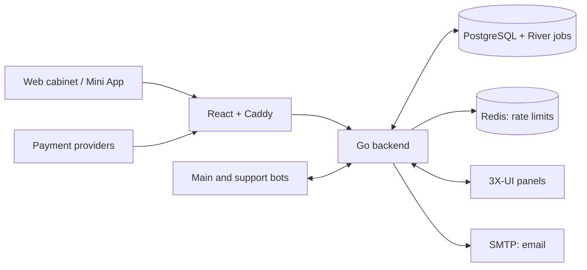

# Engineering guide

[Русский](../ru/engineering.md) · [Project](../../README.md) · [Operator guide](operators.md)

## Architecture



One `server serve` process owns HTTP, River workers, Telegram polling and
schedulers. PostgreSQL stores accounts, catalogue, orders, access operations,
support attachments and audit. Redis supplies rate limits. React and Caddy run
in a separate container; Caddy serves the UI and forwards API/payment callbacks.
3X-UI remains responsible for VPN traffic.

Payment confirmation, applying access on a panel and message delivery have
separate recorded outcomes. Database jobs allow work to continue after a
restart. A PostgreSQL lock prevents two `serve`/`reconcile` executors for the
same database; nevertheless, stop the previous process and its restart
supervisor before handing execution to another host.

## Deployment

The reference [Compose file](../../deploy/compose.yml) starts PostgreSQL and Redis,
runs migrations and exposes Caddy on HTTPS port 443. It contains local build
definitions; the override below selects published backend and web images.
It uses the existing [Caddy configuration](../../deploy/acceptance/Caddyfile).
Only the gateway publishes a port. You need Docker with Compose, a free private
subnet, a domain pointing to the host, its certificate/key, TLS SMTP and a 3X-UI
panel with working HTTPS authentication. Certificate renewal is external to
this example; Caddy automatic HTTPS is disabled.

The examples use release `0.1.1`. Use the same version for the repository
checkout and both images. For a new installation:

```sh
git clone --branch 0.1.1 https://github.com/ekho/3xui-mole.git
cd 3xui-mole
```

Run the remaining commands from this repository root. Create private
configuration outside Git:

```sh
umask 077
mkdir -p /secure/mole
chmod 700 /secure/mole
cp deploy/.env.example /secure/mole/deployment.env
openssl rand -hex 24 > /secure/mole/pg-password
openssl rand -base64 32 > /secure/mole/mail-key
openssl rand -base64 32 > /secure/mole/code-key
```

Edit `deployment.env` using the [example](../../deploy/.env.example). Replace all
example addresses and paths, publish the policy documents, and prepare files:

| File | Contents |
| --- | --- |
| `database-url` | `postgres://cabinet:<pg-password>@postgres:5432/cabinet?sslmode=disable`, using the generated password and the configured PostgreSQL user/database. |
| `redis-url` | `redis://redis:6379/0` for this private Compose network. |
| `smtp-password` | SMTP account password. |
| `panel-token` | 3X-UI API token; alternatively select username/password authentication below. |
| `cabinet-cert.pem`, `cabinet-key.pem` | Certificate chain and private key for `CABINET_HOST`. |

The database URL above disables TLS only within this isolated container network.
For external databases use TLS with certificate verification. Keep secret files
at `0600`, readable by the configured `APP_RUNTIME_UID` (default `10001`);
protected directories must also be traversable by that user. The container
mounts files read-only. Retain the generated `MAIL_KEY_FILE` and `CODE_KEY_FILE`
for the life of the installation: do not regenerate them during updates.

Set the actual domain consistently, for example:

```dotenv
PRODUCT_NAME=3xui-mole
CABINET_HOST=cabinet.example.com
CABINET_ORIGIN=https://cabinet.example.com
TERMS_VERSION=1
PRIVACY_VERSION=1
TERMS_URL=https://example.com/terms
PRIVACY_URL=https://example.com/privacy
SUPPORT_URL=mailto:support@example.com
PANEL_ID=default
PANEL_URL=https://panel.example.com
SUBSCRIPTION_BASE_URL=https://subscriptions.example.com/sub/
```

`PANEL_DUPLICATE_GUARD_VERIFIED` stays false until you verify duplicate/repeated
client operations against your actual panel in a controlled test. Only then
set it to true for access provisioning. Keep panel and server identities stable
when updating an existing installation.

Create an image override outside Git. `migrate`, `backend` and `reconcile` use
the same backend image; `gateway` uses the web image:

```sh
cat > /secure/mole/compose.images.yml <<'YAML'
services:
  migrate:
    image: &backend-image ghcr.io/ekho/3xui-mole:backend-0.1.1
  backend:
    image: *backend-image
  reconcile:
    image: *backend-image
  gateway:
    image: ghcr.io/ekho/3xui-mole:web-0.1.1
YAML
```

Validate, download the images and start without rebuilding:

```sh
printf 'SOURCE_REVISION=%s\n' "$(git rev-parse HEAD)" >> /secure/mole/deployment.env
docker compose --env-file /secure/mole/deployment.env \
  -f deploy/compose.yml -f /secure/mole/compose.images.yml config --quiet
docker compose --env-file /secure/mole/deployment.env \
  -f deploy/compose.yml -f /secure/mole/compose.images.yml pull
docker compose --env-file /secure/mole/deployment.env \
  -f deploy/compose.yml -f /secure/mole/compose.images.yml up -d --no-build
docker compose --env-file /secure/mole/deployment.env \
  -f deploy/compose.yml -f /secure/mole/compose.images.yml ps
curl --fail https://cabinet.example.com/readyz
```

Check `/config.json`, policy links, both UI languages and an email registration.
After granting operator access, create the first visible plan and perform a
controlled trial/purchase with panel readback after enabling that feature.
`/readyz` checks PostgreSQL, Redis and workers; check Telegram and external
providers separately.

Keep the same Compose project, env file and enabled overlays for every command.
`config --quiet` validates without printing configuration. Use `config --images`
when you need image names; do not publish private configuration or logs with
customer credentials. To build your own images, omit `compose.images.yml`
and use `up -d --build` with the intended source checkout.

## Configuration reference

Settings are read on process start. Ordinary values and secret-file paths go
in the env file; secrets go in files named by `*_FILE`. Plaintext variables
such as `DATABASE_URL`, `REDIS_URL`, `MAIL_KEY`, `CODE_KEY` and provider tokens
are not substitutes for files. Invalid/empty secret files stop the relevant
configuration; there is no fallback.

### Core, email and public web settings

| Settings | Meaning / default |
| --- | --- |
| `DATABASE_URL_FILE`, `REDIS_URL_FILE` | Required connection URIs. |
| `MAIL_KEY_FILE`, `CODE_KEY_FILE` | Required base64-encoded 32-byte keys. Preserve across restart and restore. |
| `CABINET_ORIGIN` | Required exact HTTPS origin, without credentials, path, query or fragment. |
| `TERMS_VERSION`, `PRIVACY_VERSION` | Required consent versions, identical in backend and gateway; at most 128 UTF-8 bytes for web config. |
| `LISTEN_ADDRESS` | `127.0.0.1:8080`; the container uses `0.0.0.0:8080` on the private network. |
| `TRUSTED_PROXY_CIDRS` | Comma-separated trusted proxy networks. The example trusts only the gateway's `/32`; never trust arbitrary forwarded client addresses. |
| `SMTP_ADDRESS`, `SMTP_USER`, `SMTP_FROM`, `SMTP_PASSWORD_FILE` | TLS SMTP connection and sender; password is required when a user is configured. |
| `SMTP_CA_FILE` | Optional additional SMTP trust root. |
| `OPERATIONS_EMAIL_FILE` | Optional single private recipient for best-effort lifecycle reports. `OPERATIONS_EMAIL` is forbidden, even empty. |
| `PRODUCT_NAME` | Optional display name, up to 128 UTF-8 bytes. The example uses `3xui-mole`. |
| `TERMS_URL`, `PRIVACY_URL`, `SUPPORT_URL` | Required public URLs, up to 2048 bytes. HTTPS without credentials; support also accepts `mailto:`. |
| `WEB_PUBLIC_CONFIG_DIR` | `/run/web-public`, writable by Caddy; the example mounts tmpfs. |
| `CABINET_HOST`, `PUBLIC_CERT_FILE`, `PUBLIC_KEY_FILE` | Gateway host and TLS files. The certificate must match the host. |
| `CABINET_MAINTENANCE` | `false`; when true the gateway returns 503 except for payment callback routes. Separate from business maintenance in `/admin`. |
| `APP_RUNTIME_UID`, `APP_RUNTIME_GID` | Compose runtime user/group, `10001`. |
| `APP_NETWORK_SUBNET`, `APP_GATEWAY_IP` | Compose network and fixed trusted gateway IP; choose an unused subnet. |
| `PG_USER`, `BASE_DATABASE`, `PG_PASSWORD_FILE` | Compose PostgreSQL user/database (`cabinet`) and initial password file. Changing these does not modify an existing database volume. |
| `SOURCE_REVISION` | Required by the Compose build definition; use the checked-out release commit. Published images already contain the revision embedded by CI. |

The gateway generates `/config.json` at startup with only policy versions,
public URLs and the display name. Telegram links are not accepted as policy/support URLs.
Secrets are never included. Missing or
invalid public configuration blocks registration. A new domain also needs
matching DNS/TLS and policy URLs; cookies from the previous origin do not move.

### Panels, trials and rewards

| Settings | Meaning / default |
| --- | --- |
| `PANEL_ID` | Stable default panel identity; required for enabled trials. |
| `PANEL_URL`, `SUBSCRIPTION_BASE_URL` | HTTPS panel and subscription URLs without credentials/query/fragment. The latter includes the subscription path, such as `/sub/`. |
| `PANEL_TOKEN_FILE` **or** `PANEL_USERNAME` + `PANEL_PASSWORD_FILE` | Choose one authentication method. Leave the unused method empty. |
| `PANEL_CA_FILE` | Optional private panel trust root; TLS verification remains enabled. |
| `PANEL_DUPLICATE_GUARD_VERIFIED` | `false`; requires the panel verification described above. |
| `TRIAL_ENABLED` | `false`; enables starter trial admission, subject to approval and one-trial checks. |
| `TRIAL_PERIOD`, `TRIAL_TRAFFIC_GB`, `BONUS_DEVICES_COUNT` | 3 days, 15 GiB, 1 device. Traffic `0` means unlimited. |
| `ACCESS_RESET_TIMEZONE` | `UTC`; timezone for monthly unlimited traffic resets. |
| `SHOP_REFERRED_TRIAL_ENABLED`, `SHOP_REFERRED_TRIAL_PERIOD` | `false`, 7 days; optional trial benefit for invited clients. |
| `SHOP_REFERRER_REWARD_ENABLED` | `true`; enables day rewards for qualifying paid purchases. |
| `SHOP_REFERRER_LEVEL_ONE_PERIOD`, `SHOP_REFERRER_LEVEL_TWO_PERIOD` | 10 and 3 days, each 0–365; 0 disables that level. |
| `SHOP_REFERRED_REWARD_TYPE` | `days`; `money` disables native rewards, it does not enable payouts. |

Catalogue plans/prices, server registry, account permissions and business
maintenance are stored in PostgreSQL and managed through their operator tools.
They are not replaced by an env change.

Prepare enabled 3X-UI inbounds with a hyphen-separated tag segment `regular`,
`euru` or `unlimited`, for example `inbound-443-regular`. Unlimited also includes
regular inbounds. A profile with no matching enabled inbound cannot be applied;
verify the panel integration before offering that profile in the catalogue.

### Telegram and audit

| Settings | Meaning / default |
| --- | --- |
| `TELEGRAM_ENABLED`, `BOT_TOKEN_FILE` | `false`; enabling the main bot requires its token and operator IDs. |
| `BOT_OPERATOR_IDS` | Comma-separated positive Telegram user IDs. Web operator/infrastructure roles are still granted separately. |
| `SUPPORT_TELEGRAM_ENABLED`, `SUPPORT_BOT_TOKEN_FILE`, `SUPPORT_GROUP_ID` | `false`; separate support bot and negative forum supergroup ID. The bot must be an administrator able to manage topics. |
| `AUDIT_MIRROR_ENABLED` | `false`; uses the support bot/group for audit metadata. |
| `AUDIT_RETENTION_DAYS` | 365, allowed 1–3650. |
| `AUDIT_RETENTION_TIMEZONE`, `BOT_TIMEZONE` | Audit timezone → bot timezone → `UTC`; use IANA names such as `Europe/Moscow`, not `Local`. |

Run only one poller per bot and remove any existing Telegram webhook before
using polling. Main and support tokens must identify different bots. A bad
main-bot configuration prevents startup; a support-channel error can leave
web/core running with degraded support. Readiness alone does not verify bots.
Configure the bot's main Mini App at `https://cabinet.example.com/mini-app/cabinet`
before enabling it. Startup verifies that the bot has a main Mini App and sets
the chat menu button to this URL.

## Payment configuration

All `SHOP_PAYMENT_*_ENABLED` flags default to false. Add the matching file from
`deploy/purchase/` to every Compose command and set its credentials/flag:

| Method / overlay | Settings | Currency |
| --- | --- | --- |
| Manual / [compose.manual.yml](../../deploy/purchase/compose.manual.yml) | `SHOP_PAYMENT_MANUAL_ENABLED`, `MANUAL_CARD_DETAILS_FILE` (plain-text customer instructions). | RUB |
| YooMoney / [compose.yoomoney.yml](../../deploy/purchase/compose.yoomoney.yml) | `SHOP_PAYMENT_YOOMONEY_ENABLED`, `YOOMONEY_WALLET_ID`, `YOOMONEY_NOTIFICATION_SECRET_FILE`. | RUB |
| YooKassa / [compose.yookassa.yml](../../deploy/purchase/compose.yookassa.yml) | `SHOP_PAYMENT_YOOKASSA_ENABLED`, `YOOKASSA_SHOP_ID`, `YOOKASSA_TOKEN_FILE`, `SHOP_EMAIL`, `YOOKASSA_TEST_MODE` (`false`). | RUB |
| Cryptomus / [compose.cryptomus.yml](../../deploy/purchase/compose.cryptomus.yml) | `SHOP_PAYMENT_CRYPTOMUS_ENABLED`, `CRYPTOMUS_MERCHANT_ID`, `CRYPTOMUS_API_KEY_FILE`. | USD |
| Heleket / [compose.heleket.yml](../../deploy/purchase/compose.heleket.yml) | `SHOP_PAYMENT_HELEKET_ENABLED`, `HELEKET_MERCHANT_ID`, `HELEKET_API_KEY_FILE`. | USD |
| Stars / base Compose | `SHOP_PAYMENT_STARS_ENABLED`, configured main Telegram bot. | XTR |

For example, add `SHOP_PAYMENT_MANUAL_ENABLED=true` and the absolute
`MANUAL_CARD_DETAILS_FILE` path to your private env file, then use:

```sh
docker compose --env-file /secure/mole/deployment.env \
  -f deploy/compose.yml -f deploy/purchase/compose.manual.yml \
  -f /secure/mole/compose.images.yml config --quiet
docker compose --env-file /secure/mole/deployment.env \
  -f deploy/compose.yml -f deploy/purchase/compose.manual.yml \
  -f /secure/mole/compose.images.yml up -d --no-build
```

Configure provider callbacks at `https://cabinet.example.com/webhooks/PROVIDER`,
where `PROVIDER` is `yoomoney`, `yookassa`, `cryptomus` or `heleket`. Caddy also
keeps their short callback paths for existing integrations. Preserve callbacks
through maintenance and trust only verified provider events. Retain credentials
when disabling new sales: pending events, reconciliation and refunds still
need them. Catalogue prices must exist in the method's currency.

## Operator access

Register and verify the intended operator account. Obtain its account UUID
from the authenticated `/api/v1/me` response and save it in a private `0600`
file owned by the CLI user. With the reference container user, the mounted
file must be readable by UID `10001`. Grant roles:

```sh
docker compose --env-file /secure/mole/deployment.env -f deploy/compose.yml \
  -f /secure/mole/compose.images.yml \
  run --rm --no-deps -v /secure/mole/operator-account:/run/operator-account:ro \
  backend operator grant --account-file /run/operator-account
docker compose --env-file /secure/mole/deployment.env -f deploy/compose.yml \
  -f /secure/mole/compose.images.yml \
  run --rm --no-deps -v /secure/mole/operator-account:/run/operator-account:ro \
  backend infrastructure grant --account-file /run/operator-account
```

Infrastructure permission requires an existing operator role. Use `revoke`
instead of `grant` to remove a role; revoking operator access also removes
infrastructure access. Role commands need only `DATABASE_URL_FILE` when run
as a host binary. Do not grant roles by manually editing database rows.

## Updates and recovery

Before updating, take a backup, record the current revision/images and enable
business maintenance. Check out the target release tag, update `SOURCE_REVISION`
to its commit and change both image tags in `compose.images.yml` to that version.
Download them with the same Compose `pull` command, then stop the backend with
SIGTERM and allow the configured 75-second grace period. Run `migrate` with the
new image, then start exactly one backend and recreate the gateway if needed.
Keep the same env, secrets, project and overlays. Check readiness, pending
payments/access, panel observations and channels before reopening sales.
During backend downtime callbacks cannot be accepted; verify provider retry
and reconcile missed events afterwards.

An env/image change requires container recreation (`up -d --no-build --no-deps backend`
or `gateway` after migrating as appropriate). `restart` does not
reread env. Never use `down -v` for an update: it deletes the database volume.

`server reconcile` runs the payment/provisioning queues without HTTP, email
schedulers or Telegram polling. Stop `serve` and its supervisor first, run
reconciliation under supervision, stop it with SIGTERM, then restart `serve`.
It must not run alongside `serve` against the same database.

For rollback, check the current and candidate binaries with `server cutover-check`
and the same private `DATABASE_URL_FILE`. Each must succeed and report its
expected `source_revision`; both must have the same `schema` and
`legacy_receipts_version=1`. Use the
verified image/binary with the current database; an old image or SQLite copy
is not a safe substitute. Do not roll back schema or discard new payments.

## Backups and restore checks

`server backup create` saves PostgreSQL schema/data, River jobs, sequences and
stored support attachments. It does not save env, secrets, certificates,
Redis or external 3X-UI/provider/Telegram state. Back up private deployment
files separately. The database dump contains sensitive customer data.

The CLI needs `pg_dump` and `pg_restore` matching the PostgreSQL major. The
ordinary backend image does not contain them. For Docker, build the existing
operations image with `docker build --target operations -t 3xui-mole-operations:local backend`.
For a host binary with those utilities installed:

```sh
go -C backend build -o /secure/mole/server ./cmd/server
DATABASE_URL_FILE=/secure/mole/database-url \
  /secure/mole/server backup create --operator-file /secure/mole/operator-account \
  --directory /secure/mole/snapshot-20261011
```

The host binary example needs a host-reachable database URL, not the internal
Compose hostname. Database URL and operator UUID files must be absolute,
canonical regular files, owned by the executing OS user, mode `0600`, with
no symlinks in their paths. Use a protected parent directory and a destination
that does not exist. Backup briefly blocks writes; do not run migrations
concurrently. Use explicit TLS options for external PostgreSQL. The backup URI
supports only `sslmode`, `sslrootcert`, `sslcert` and `sslkey`; remove ambient
connection-changing `PG*` variables. Verified TLS needs an explicit trust root.

Test restoration on a separate PostgreSQL instance with a `LOGIN CREATEDB`
role without superuser rights and a separate `RESTORE_DATABASE_URL_FILE`:

```sh
DATABASE_URL_FILE=/secure/mole/database-url \
RESTORE_DATABASE_URL_FILE=/secure/mole/restore-database-url \
  /secure/mole/server backup rehearse --operator-file /secure/mole/operator-account \
  --directory /secure/mole/snapshot-20261011 --target rehearsal_20261011
```

A successful backup is not a verified restore. Rehearsal creates a new
`rehearsal_...` database and checks schema, rows, sequences and attachments.
Use a trusted package and a matching backend revision/PostgreSQL major. Missing
attachment bytes cause `BACKUP_INCOMPLETE`. A failed rehearsal leaves its new
DB for inspection; do not attach runtime to it or reuse that target name.
Never run `serve` or `reconcile` against a rehearsal copy. Before a real restore,
stop writers, keep keys, reconcile external state and apply the existing
[post-restore authentication cleanup](../../backend/db/maintenance/post_restore_auth.sql)
to invalidate copied login/recovery state.

## Importing an existing SQLite installation

The current CLI can export a supported SQLite snapshot and import it into
migrated PostgreSQL. Stop all source writers, take a consistent private snapshot
and keep the original stable identities. Import requires a verified web operator;
it does not grant roles or execute old pending rewards.

```sh
umask 077
/secure/mole/server export-legacy /secure/mole/source.sqlite \
  --source initial-import --support-bot-id 12345 --support-group-id -10012345 \
  > /secure/mole/import.json
DATABASE_URL_FILE=/secure/mole/database-url \
  /secure/mole/server import-legacy --dry-run --operator-file /secure/mole/operator-account \
  < /secure/mole/import.json
DATABASE_URL_FILE=/secure/mole/database-url \
  /secure/mole/server import-legacy --apply --operator-file /secure/mole/operator-account \
  < /secure/mole/import.json
```

Replace the example bot/group IDs with the actual source identities. Check
export success before importing. Apply the same private-file rules as backup;
keep the same source name/package for retries. A conflicting snapshot must be
investigated, not imported under another name. Verify identities, financial
history, panel readback and a backup/restore before opening access. Late imported
payment observations are available through `server legacy-payments --operator-file`;
they do not automatically create new paid orders or access.

## Development and checks

Use the Go version from [go.mod](../../backend/go.mod) (currently 1.27.1) and Node
24.11.1 as pinned in the [web Dockerfile](../../web/Dockerfile). Build from source:

```sh
go -C backend build -o server ./cmd/server
npm --prefix web ci --ignore-scripts
npm --prefix web run build
```

For local web development, run `npm --prefix web run dev` and open the printed
URL. The dev server serves a synthetic public configuration; API requests need a
local backend or mocks. React Fast Refresh preserves component state while editing.
Use `npm --prefix web run lint` for React Hooks checks,
`npm --prefix web run format` for formatting (generated API types are excluded),
and `npm --prefix web run test:dev` to check development CSP and Fast Refresh.
TypeScript stays on 5.9 while `openapi-typescript` requires its 5.x peer dependency.


The [OpenAPI contract](../api/openapi.yaml) generates Go/TypeScript API types:
`make -C backend generate` and `npm --prefix web run api:generate`.
For focused verification use `go -C backend test ./...`,
`npm --prefix web run typecheck` and `python3 -m unittest discover -s tests -v`.
Connected Go and browser checks need dedicated PostgreSQL/Redis and other test
fixtures; the existing `deploy/acceptance/` scripts create synthetic resources.
Do not point them at a live installation.

Customer screens use React Router: internal cabinet links and order creation
change routes without a document reload. Language is stored in the `lang=en`
URL parameter; Russian is the default. Authentication, verification and logout
keep document navigation so session and one-time proof state are reset.

Customer cabinet, catalogue and referrals reads use TanStack Query with an
instance per mounted customer session. Queries forward cancellation signals and
keep data in memory only; inactive reads are discarded immediately. Session ending
and page exit clear the cache, and a restored browser page reloads session state.
Pending cabinet operations are polled five seconds after the preceding read ends.
Automatic retries are disabled; the cabinet retains its existing transient-error
polling. Financial writes remain explicit and subscription connection keys never
enter the query cache.

## CI and releases

Each push to `main`, including a merged pull request, runs Platform checks,
then builds and publishes the backend and cabinet images to GHCR for
`linux/amd64` and `linux/arm64`. Both images share one GHCR package:
`ghcr.io/<owner>/3xui-mole`, with `backend-<version>` and `web-<version>` tags.
Each component also receives its own `<component>-latest` and
`<component>-sha-<full-commit>` tags. For example:

```sh
docker pull ghcr.io/ekho/3xui-mole:backend-0.1.1
docker pull ghcr.io/ekho/3xui-mole:web-0.1.1
```

The GitHub Release is published after both image builds succeed.

Versioning starts at `0.1.0` and automatically increments patch (`0.1.1`,
`0.1.2`, ...); legacy and preview tags are ignored. CI reserves the Git tag
after checks pass, so retrying a failed build keeps the same version. Rerunning
an older release after a newer tag exists is rejected to protect the component
`latest` tags.
Pull requests run checks without publishing. The workflow uses the built-in
`GITHUB_TOKEN`; no additional publication secrets are needed. When deploying,
use an explicit release version for both images, as in the [deployment example](#deployment).
