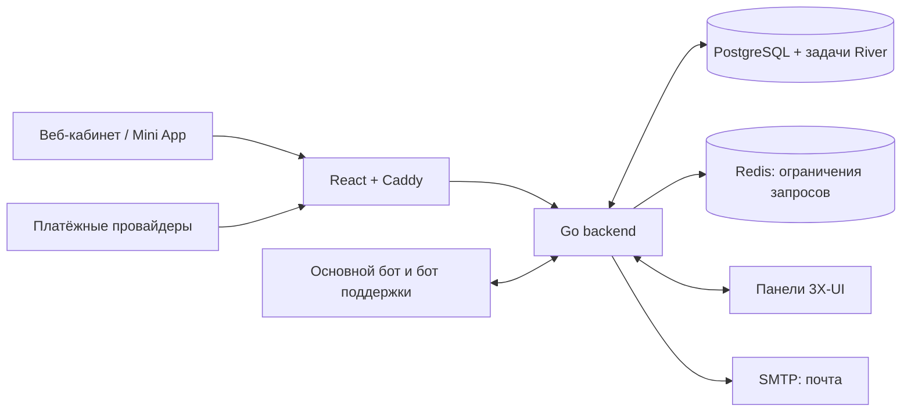

# Инженерное руководство

[English](../en/engineering.md) · [О проекте](../../README.ru_RU.md) · [Руководство оператора](operators.md)

## Архитектура



Один процесс `server serve` обслуживает HTTP, задачи River, получение сообщений
Telegram и расписания. PostgreSQL хранит аккаунты, каталог, заказы, операции
доступа, вложения поддержки и аудит. Redis ограничивает частоту запросов.
React и Caddy работают в отдельном контейнере: Caddy отдаёт интерфейс
и передаёт API-запросы и события платежей. За VPN-трафик отвечает 3X-UI.

Подтверждение оплаты, применение доступа на панели и доставка сообщений
имеют отдельные сохранённые результаты. Очередь в БД позволяет продолжать работу
после перезапуска. Блокировка PostgreSQL запрещает два исполнителя
`serve`/`reconcile` на одной БД; при передаче работы другому хосту всё равно
нужно остановить прежний процесс и его автоматический перезапуск.

## Деплой

Пример [Compose](../../deploy/compose.yml) запускает PostgreSQL и Redis,
применяет миграции и открывает Caddy на HTTPS-порту 443. В нём заданы локальные
сборки; дополнение ниже выбирает опубликованные образы backend и веба.
Он использует существующую [конфигурацию Caddy](../../deploy/acceptance/Caddyfile).
Наружу публикуется только шлюз. Нужны Docker с Compose, свободная частная
подсеть, домен с DNS-записью на хост, сертификат и ключ, SMTP с TLS и панель
3X-UI с рабочей HTTPS-авторизацией. Сертификат обновляется отдельно:
автоматический HTTPS Caddy в этом примере выключен.

Примеры используют релиз `0.1.1`. Версия исходников и обоих образов должна
совпадать. Для новой установки:

```sh
git clone --branch 0.1.1 https://github.com/ekho/3xui-mole.git
cd 3xui-mole
```

Остальные команды выполняйте из корня этого репозитория. Создайте приватную
конфигурацию вне Git:

```sh
umask 077
mkdir -p /secure/mole
chmod 700 /secure/mole
cp deploy/.env.example /secure/mole/deployment.env
openssl rand -hex 24 > /secure/mole/pg-password
openssl rand -base64 32 > /secure/mole/mail-key
openssl rand -base64 32 > /secure/mole/code-key
```

Заполните `deployment.env` по [примеру](../../deploy/.env.example). Замените
адреса и пути, опубликуйте документы и подготовьте файлы:

| Файл | Содержимое |
| --- | --- |
| `database-url` | `postgres://cabinet:<pg-password>@postgres:5432/cabinet?sslmode=disable`, с созданным паролем и выбранными пользователем/БД PostgreSQL. |
| `redis-url` | `redis://redis:6379/0` для частной сети этого Compose. |
| `smtp-password` | Пароль учётной записи SMTP. |
| `panel-token` | API-токен 3X-UI; вместо него можно выбрать логин/пароль, как описано ниже. |
| `cabinet-cert.pem`, `cabinet-key.pem` | Цепочка сертификатов и приватный ключ для `CABINET_HOST`. |

В примере URL БД TLS выключен только внутри изолированной контейнерной сети.
Для внешней БД используйте TLS с проверкой сертификата. Права файлов секретов —
`0600`; читать их должен пользователь `APP_RUNTIME_UID` (по умолчанию `10001`).
Ему также нужен доступ к каталогам в пути. В контейнер файлы монтируются
только для чтения. Сохраните `MAIL_KEY_FILE` и `CODE_KEY_FILE` на весь срок
жизни установки: при обновлении не создавайте их заново.

Согласованно задайте фактический домен, например:

```dotenv
PRODUCT_NAME=3xui-mole
CABINET_HOST=cabinet.example.com
CABINET_ORIGIN=https://cabinet.example.com
TERMS_VERSION=1
PRIVACY_VERSION=1
TERMS_URL=https://example.com/terms
PRIVACY_URL=https://example.com/privacy
SUPPORT_URL=mailto:support@example.com
PANEL_ID=default
PANEL_URL=https://panel.example.com
SUBSCRIPTION_BASE_URL=https://subscriptions.example.com/sub/
```

Оставьте `PANEL_DUPLICATE_GUARD_VERIFIED=false`, пока не проверите обработку
дубликатов и повторных операций с клиентом на своей панели в контролируемом
тесте. Только после проверки включайте флаг для выдачи доступа. При обновлении
существующей установки сохраняйте идентификаторы панелей и серверов.

Создайте дополнение с образами вне Git. Сервисы `migrate`, `backend` и
`reconcile` используют один образ backend, а `gateway` — образ веба:

```sh
cat > /secure/mole/compose.images.yml <<'YAML'
services:
  migrate:
    image: &backend-image ghcr.io/ekho/3xui-mole:backend-0.1.1
  backend:
    image: *backend-image
  reconcile:
    image: *backend-image
  gateway:
    image: ghcr.io/ekho/3xui-mole:web-0.1.1
YAML
```

Проверьте конфигурацию, скачайте образы и запустите без пересборки:

```sh
printf 'SOURCE_REVISION=%s\n' "$(git rev-parse HEAD)" >> /secure/mole/deployment.env
docker compose --env-file /secure/mole/deployment.env \
  -f deploy/compose.yml -f /secure/mole/compose.images.yml config --quiet
docker compose --env-file /secure/mole/deployment.env \
  -f deploy/compose.yml -f /secure/mole/compose.images.yml pull
docker compose --env-file /secure/mole/deployment.env \
  -f deploy/compose.yml -f /secure/mole/compose.images.yml up -d --no-build
docker compose --env-file /secure/mole/deployment.env \
  -f deploy/compose.yml -f /secure/mole/compose.images.yml ps
curl --fail https://cabinet.example.com/readyz
```

Проверьте `/config.json`, документы, оба языка интерфейса и регистрацию с письмом.
После выдачи роли оператора создайте первый видимый тариф и проведите
контролируемую выдачу пробного/платного доступа со сверкой на панели после
включения соответствующей функции.
`/readyz` проверяет PostgreSQL, Redis и фоновые задачи; Telegram и внешних
провайдеров проверяйте отдельно.

Во всех командах сохраняйте тот же проект Compose, env-файл и набор дополнений.
`config --quiet` проверяет конфигурацию без её вывода. Для списка образов
используйте `config --images`; не публикуйте приватную конфигурацию и журналы
с данными доступа клиентов. Для собственной сборки уберите `compose.images.yml`
и используйте `up -d --build` с нужной ревизией исходников.

## Справочник настроек

Настройки читаются при запуске процесса. Обычные значения и пути к секретам
хранятся в env-файле, сами секреты — в файлах `*_FILE`. Переменные с открытым
значением, например `DATABASE_URL`, `REDIS_URL`, `MAIL_KEY`, `CODE_KEY` и токены
провайдеров, не заменяют файлы. Некорректный или пустой файл останавливает
соответствующую конфигурацию; запасного способа чтения нет.

### Основа, почта и публичные настройки веба

| Настройки | Значение / по умолчанию |
| --- | --- |
| `DATABASE_URL_FILE`, `REDIS_URL_FILE` | Обязательные URI подключения. |
| `MAIL_KEY_FILE`, `CODE_KEY_FILE` | Обязательные ключи из 32 байт в base64. Сохраняются при перезапуске и восстановлении. |
| `CABINET_ORIGIN` | Обязательный точный HTTPS origin — протокол и хост без логина, пути, query и fragment. |
| `TERMS_VERSION`, `PRIVACY_VERSION` | Обязательные версии согласий, одинаковые у backend и шлюза; для веб-конфигурации до 128 байт UTF-8. |
| `LISTEN_ADDRESS` | `127.0.0.1:8080`; в контейнере — `0.0.0.0:8080` в частной сети. |
| `TRUSTED_PROXY_CIDRS` | Доверенные сети прокси через запятую. Пример доверяет только `/32` шлюза; произвольным пересланным адресам клиента доверять нельзя. |
| `SMTP_ADDRESS`, `SMTP_USER`, `SMTP_FROM`, `SMTP_PASSWORD_FILE` | SMTP с TLS и отправитель; при заданном пользователе обязателен пароль. |
| `SMTP_CA_FILE` | Необязательный дополнительный доверенный сертификат SMTP. |
| `OPERATIONS_EMAIL_FILE` | Необязательный приватный адрес для уведомлений о работе процесса; доставка не гарантируется. `OPERATIONS_EMAIL` запрещён, даже пустой. |
| `PRODUCT_NAME` | Необязательное название до 128 байт UTF-8. В примере — `3xui-mole`. |
| `TERMS_URL`, `PRIVACY_URL`, `SUPPORT_URL` | Обязательные публичные URL до 2048 байт. HTTPS без логина/пароля; для поддержки также разрешён `mailto:`. |
| `WEB_PUBLIC_CONFIG_DIR` | `/run/web-public`, доступен Caddy для записи; в примере используется tmpfs. |
| `CABINET_HOST`, `PUBLIC_CERT_FILE`, `PUBLIC_KEY_FILE` | Домен шлюза и файлы TLS. Сертификат должен соответствовать домену. |
| `CABINET_MAINTENANCE` | `false`; при true шлюз отвечает 503, кроме маршрутов событий оплаты. Это отдельный режим от обслуживания в `/admin`. |
| `APP_RUNTIME_UID`, `APP_RUNTIME_GID` | Пользователь/группа контейнеров Compose, `10001`. |
| `APP_NETWORK_SUBNET`, `APP_GATEWAY_IP` | Сеть Compose и фиксированный адрес доверенного шлюза; выбирайте свободную подсеть. |
| `PG_USER`, `BASE_DATABASE`, `PG_PASSWORD_FILE` | Пользователь/БД PostgreSQL (`cabinet`) и файл начального пароля. Изменение не меняет существующий том БД. |
| `SOURCE_REVISION` | Обязателен для описания сборки в Compose; укажите коммит выбранного релиза. В опубликованный образ ревизия уже встроена CI. |

При запуске шлюз создаёт `/config.json` только с версиями документов,
публичными URL и названием. Ссылки Telegram не подходят для документов/поддержки.
Секретов в нём нет. Отсутствующая или некорректная
публичная конфигурация запрещает регистрацию. Смена домена также требует
согласованных DNS/TLS и URL документов; cookies прежнего origin не переносятся.

### Панели, пробный доступ и награды

| Настройки | Значение / по умолчанию |
| --- | --- |
| `PANEL_ID` | Постоянный идентификатор панели по умолчанию; обязателен при включённых пробных подписках. |
| `PANEL_URL`, `SUBSCRIPTION_BASE_URL` | HTTPS-адреса панели и подписки без логина, query и fragment. Второй включает путь подписки, например `/sub/`. |
| `PANEL_TOKEN_FILE` **или** `PANEL_USERNAME` + `PANEL_PASSWORD_FILE` | Выберите один способ авторизации. Неиспользуемый оставьте пустым. |
| `PANEL_CA_FILE` | Необязательный доверенный сертификат панели; проверка TLS остаётся включённой. |
| `PANEL_DUPLICATE_GUARD_VERIFIED` | `false`; требует описанной выше проверки панели. |
| `TRIAL_ENABLED` | `false`; разрешает пробный доступ с согласованием и проверкой однократности. |
| `TRIAL_PERIOD`, `TRIAL_TRAFFIC_GB`, `BONUS_DEVICES_COUNT` | 3 дня, 15 GiB, 1 устройство. Трафик `0` — без лимита. |
| `ACCESS_RESET_TIMEZONE` | `UTC`; часовой пояс месячного сброса трафика unlimited. |
| `SHOP_REFERRED_TRIAL_ENABLED`, `SHOP_REFERRED_TRIAL_PERIOD` | `false`, 7 дней; дополнительный пробный период приглашённому клиенту. |
| `SHOP_REFERRER_REWARD_ENABLED` | `true`; награды днями за подходящие подтверждённые покупки. |
| `SHOP_REFERRER_LEVEL_ONE_PERIOD`, `SHOP_REFERRER_LEVEL_TWO_PERIOD` | 10 и 3 дня, от 0 до 365; 0 отключает уровень. |
| `SHOP_REFERRED_REWARD_TYPE` | `days`; `money` отключает новые награды и не включает выплаты. |

Тарифы и цены, реестр серверов, права аккаунтов и режим обслуживания хранятся
в PostgreSQL и управляются инструментами оператора. Смена env их не заменяет.

Подготовьте включённые входящие подключения (inbound) 3X-UI с отдельным
сегментом тега `regular`, `euru` или `unlimited`, разделённым дефисами,
например `inbound-443-regular`. Unlimited включает также regular.
Профиль без подходящих включённых inbound не применяется; проверьте интеграцию
с панелью до предложения этого профиля в каталоге.

### Telegram и аудит

| Настройки | Значение / по умолчанию |
| --- | --- |
| `TELEGRAM_ENABLED`, `BOT_TOKEN_FILE` | `false`; для основного бота нужны токен и ID операторов. |
| `BOT_OPERATOR_IDS` | Положительные Telegram user ID через запятую. Роли operator/infrastructure в вебе выдаются отдельно. |
| `SUPPORT_TELEGRAM_ENABLED`, `SUPPORT_BOT_TOKEN_FILE`, `SUPPORT_GROUP_ID` | `false`; отдельный бот поддержки и отрицательный ID супергруппы с темами. Боту нужны права администратора с управлением темами. |
| `AUDIT_MIRROR_ENABLED` | `false`; использует бота/группу поддержки для метаданных аудита. |
| `AUDIT_RETENTION_DAYS` | 365, допустимо 1–3650. |
| `AUDIT_RETENTION_TIMEZONE`, `BOT_TIMEZONE` | Часовой пояс аудита → бота → `UTC`; имена IANA, например `Europe/Moscow`, вместо `Local`. |

Для каждого бота должен работать один получатель сообщений; перед polling
удалите существующий Telegram webhook. Основной бот и поддержка используют
разные токены. Некорректная конфигурация основного бота запрещает запуск;
ошибка поддержки может оставить веб и основную систему работающими
с недоступным каналом поддержки. Readiness сама по себе не проверяет ботов.
До включения настройте основной Mini App бота с URL
`https://cabinet.example.com/mini-app/cabinet`. При запуске проверяется наличие
основного Mini App и устанавливается кнопка меню чата с этим URL.

## Настройка оплат

Все флаги `SHOP_PAYMENT_*_ENABLED` по умолчанию false. Добавьте нужный файл
из `deploy/purchase/` во все команды Compose и задайте его параметры/флаг:

| Способ / дополнение | Настройки | Валюта |
| --- | --- | --- |
| Ручной / [compose.manual.yml](../../deploy/purchase/compose.manual.yml) | `SHOP_PAYMENT_MANUAL_ENABLED`, `MANUAL_CARD_DETAILS_FILE` (текст инструкции клиенту). | RUB |
| YooMoney / [compose.yoomoney.yml](../../deploy/purchase/compose.yoomoney.yml) | `SHOP_PAYMENT_YOOMONEY_ENABLED`, `YOOMONEY_WALLET_ID`, `YOOMONEY_NOTIFICATION_SECRET_FILE`. | RUB |
| YooKassa / [compose.yookassa.yml](../../deploy/purchase/compose.yookassa.yml) | `SHOP_PAYMENT_YOOKASSA_ENABLED`, `YOOKASSA_SHOP_ID`, `YOOKASSA_TOKEN_FILE`, `SHOP_EMAIL`, `YOOKASSA_TEST_MODE` (`false`). | RUB |
| Cryptomus / [compose.cryptomus.yml](../../deploy/purchase/compose.cryptomus.yml) | `SHOP_PAYMENT_CRYPTOMUS_ENABLED`, `CRYPTOMUS_MERCHANT_ID`, `CRYPTOMUS_API_KEY_FILE`. | USD |
| Heleket / [compose.heleket.yml](../../deploy/purchase/compose.heleket.yml) | `SHOP_PAYMENT_HELEKET_ENABLED`, `HELEKET_MERCHANT_ID`, `HELEKET_API_KEY_FILE`. | USD |
| Stars / основной Compose | `SHOP_PAYMENT_STARS_ENABLED`, настроенный основной Telegram-бот. | XTR |

Например, добавьте `SHOP_PAYMENT_MANUAL_ENABLED=true` и абсолютный путь
`MANUAL_CARD_DETAILS_FILE` в приватный env-файл, затем используйте:

```sh
docker compose --env-file /secure/mole/deployment.env \
  -f deploy/compose.yml -f deploy/purchase/compose.manual.yml \
  -f /secure/mole/compose.images.yml config --quiet
docker compose --env-file /secure/mole/deployment.env \
  -f deploy/compose.yml -f deploy/purchase/compose.manual.yml \
  -f /secure/mole/compose.images.yml up -d --no-build
```

У провайдера задайте URL событий `https://cabinet.example.com/webhooks/PROVIDER`,
где `PROVIDER` — `yoomoney`, `yookassa`, `cryptomus` или `heleket`. Caddy также
сохраняет короткие маршруты событий для существующих интеграций. При обслуживании
сохраняйте доставку событий и принимайте только проверенные события провайдера.
При отключении новых продаж оставьте секреты: ожидающие события, сверка
и возвраты по-прежнему требуют их. У тарифа должна быть цена в валюте оплаты.

## Доступ оператора

Зарегистрируйте и подтвердите аккаунт будущего оператора. Возьмите его UUID
из ответа `/api/v1/me` в авторизованном сеансе и сохраните в приватный файл
`0600`, принадлежащий пользователю CLI. При использовании пользователя
из примера контейнера файл должен читаться UID `10001`. Выдайте роли:

```sh
docker compose --env-file /secure/mole/deployment.env -f deploy/compose.yml \
  -f /secure/mole/compose.images.yml \
  run --rm --no-deps -v /secure/mole/operator-account:/run/operator-account:ro \
  backend operator grant --account-file /run/operator-account
docker compose --env-file /secure/mole/deployment.env -f deploy/compose.yml \
  -f /secure/mole/compose.images.yml \
  run --rm --no-deps -v /secure/mole/operator-account:/run/operator-account:ro \
  backend infrastructure grant --account-file /run/operator-account
```

Для infrastructure сначала нужна роль оператора. Для отзыва замените `grant`
на `revoke`; отзыв operator также снимает infrastructure. При запуске
host-бинарника командам ролей нужен только `DATABASE_URL_FILE`.
Не выдавайте роли прямым редактированием строк БД.

## Обновление и восстановление работы

Перед обновлением сделайте копию, сохраните текущую ревизию/образы и включите
режим обслуживания. Переключите исходники на Git-тег нового релиза, обновите
`SOURCE_REVISION` до его коммита и оба тега в `compose.images.yml` до этой версии.
Скачайте образы той же командой Compose `pull`, остановите backend через SIGTERM
и дайте ему предусмотренные 75 секунд на завершение. Выполните `migrate`
новым образом, затем запустите один backend и при необходимости пересоздайте
шлюз. Сохраните env, секреты, проект и дополнения. До открытия продаж проверьте
readiness, ожидающие платежи/доступ, панель и каналы. При остановленном backend
события провайдера не принимаются; проверьте повторную доставку и сверьте
пропущенные события после запуска.

Изменение env/образа требует пересоздания контейнера (`up -d --no-build --no-deps backend`
или `gateway`, после нужной миграции). `restart` не перечитывает env.
Не используйте `down -v` при обновлении: команда удаляет том БД.

`server reconcile` исполняет очереди оплаты и доступа без HTTP, почтовых
расписаний и получения сообщений Telegram. Сначала остановите `serve` и его
автоперезапуск, запустите сверку под наблюдением, остановите её через SIGTERM,
затем верните `serve`. Они не должны одновременно работать с одной БД.

Для отката проверьте текущий и кандидатный бинарники через `server cutover-check`
с тем же приватным `DATABASE_URL_FILE`. Каждый должен завершиться успешно
и показать свой ожидаемый `source_revision`; у обоих должны совпасть `schema`
и `legacy_receipts_version=1`. Используйте проверенный образ/бинарник с текущей БД;
старый образ или копия SQLite не являются безопасной заменой. Не откатывайте
схему и не теряйте новые платежи.

## Резервные копии и проверка восстановления

`server backup create` сохраняет схему/данные PostgreSQL, задачи River,
последовательности и сохранённые вложения поддержки. В копию не входят env,
секреты, сертификаты, Redis и внешнее состояние 3X-UI/провайдеров/Telegram.
Приватные файлы деплоя копируйте отдельно. Dump БД содержит данные клиентов.

CLI нужны `pg_dump` и `pg_restore` того же major PostgreSQL. В обычном образе
backend их нет. Для Docker соберите существующий operations-образ:
`docker build --target operations -t 3xui-mole-operations:local backend`.
Для host-бинарника с установленными утилитами:

```sh
go -C backend build -o /secure/mole/server ./cmd/server
DATABASE_URL_FILE=/secure/mole/database-url \
  /secure/mole/server backup create --operator-file /secure/mole/operator-account \
  --directory /secure/mole/snapshot-20261011
```

Для host-бинарника нужен URL БД, доступный с хоста, вместо внутреннего имени
Compose. URL БД и UUID оператора — абсолютные канонические обычные файлы
текущего пользователя ОС, с правами `0600`, без symlink в пути. Родительский
каталог должен быть защищён, каталог копии — ещё не существовать. Копирование
ненадолго блокирует запись; не запускайте миграции одновременно. Для внешнего
PostgreSQL задавайте TLS явно. URI копирования допускает только `sslmode`,
`sslrootcert`, `sslcert`, `sslkey`; уберите влияющие на подключение переменные
`PG*`. Проверка TLS требует явно заданного доверенного корня.

Проверяйте восстановление на отдельном PostgreSQL с ролью `LOGIN CREATEDB`
без superuser и отдельным `RESTORE_DATABASE_URL_FILE`:

```sh
DATABASE_URL_FILE=/secure/mole/database-url \
RESTORE_DATABASE_URL_FILE=/secure/mole/restore-database-url \
  /secure/mole/server backup rehearse --operator-file /secure/mole/operator-account \
  --directory /secure/mole/snapshot-20261011 --target rehearsal_20261011
```

Успешная копия ещё не означает проверенное восстановление. Репетиция создаёт
новую БД `rehearsal_...` и проверяет схему, строки, последовательности и вложения.
Нужны доверенная копия и соответствующие ревизия backend/major PostgreSQL.
Отсутствие байтов вложений даёт `BACKUP_INCOMPLETE`. Неудачная репетиция оставляет
новую БД для разбора; не подключайте к ней приложение и не повторяйте то же имя.
Не запускайте `serve` или `reconcile` на репетиционной копии. Перед настоящим
восстановлением остановите запись, сохраните ключи, сверьте внешнее состояние
и примените существующую [очистку данных авторизации](../../backend/db/maintenance/post_restore_auth.sql),
чтобы отозвать скопированные сеансы и данные восстановления доступа.

## Импорт существующей установки SQLite

Текущий CLI экспортирует поддерживаемый снимок SQLite и импортирует его
в PostgreSQL с применёнными миграциями. Остановите запись в источнике, сделайте
согласованный приватный снимок и сохраните исходные идентификаторы. Импорту
нужен подтверждённый веб-оператор; он не выдаёт роли и не выполняет старые
ожидающие награды.

```sh
umask 077
/secure/mole/server export-legacy /secure/mole/source.sqlite \
  --source initial-import --support-bot-id 12345 --support-group-id -10012345 \
  > /secure/mole/import.json
DATABASE_URL_FILE=/secure/mole/database-url \
  /secure/mole/server import-legacy --dry-run --operator-file /secure/mole/operator-account \
  < /secure/mole/import.json
DATABASE_URL_FILE=/secure/mole/database-url \
  /secure/mole/server import-legacy --apply --operator-file /secure/mole/operator-account \
  < /secure/mole/import.json
```

Замените ID бота/группы на реальные идентификаторы источника. Проверьте успех
экспорта до импорта. Используйте правила приватных файлов из раздела копирования;
при повторах сохраняйте имя источника и пакет. Конфликтный снимок требует разбора,
а не импорта под другим именем. До открытия доступа проверьте идентификаторы,
финансовую историю, панель и резервное копирование/восстановление. Поздние
наблюдения импортированных оплат доступны через `server legacy-payments --operator-file`;
они не создают автоматически новые оплаченные заказы или доступ.

## Разработка и проверки

Используйте версию Go из [go.mod](../../backend/go.mod), сейчас 1.27.1, и Node
24.11.1 из [Dockerfile веба](../../web/Dockerfile). Сборка из исходников:

```sh
go -C backend build -o server ./cmd/server
npm --prefix web ci --ignore-scripts
npm --prefix web run build
```

Для разработки веба запустите `npm --prefix web run dev` и откройте URL
из вывода. Сервер разработки отдаёт синтетическую публичную конфигурацию; для API
нужен локальный backend или моки. React Fast Refresh сохраняет состояние компонентов
при редактировании. `npm --prefix web run lint` проверяет React Hooks,
`npm --prefix web run format` форматирует код, кроме сгенерированных типов API,
а `npm --prefix web run test:dev` проверяет CSP сервера разработки и Fast Refresh.
TypeScript остаётся на 5.9: `openapi-typescript` требует зависимость ветки 5.x.


Из [контракта OpenAPI](../api/openapi.yaml) генерируются типы Go/TypeScript:
`make -C backend generate` и `npm --prefix web run api:generate`.
Для отдельных проверок используйте `go -C backend test ./...`,
`npm --prefix web run typecheck`, `python3 -m unittest discover -s tests -v`.
Проверкам с БД и браузером нужны выделенные PostgreSQL/Redis и другие тестовые
ресурсы; существующие скрипты `deploy/acceptance/` создают синтетические стенды.
Не направляйте их на рабочую установку.

Экраны клиента используют React Router: ссылки внутри кабинета и создание
заказа меняют маршрут без перезагрузки документа. Язык хранится в параметре
URL `lang=en`; русский используется по умолчанию. Вход, подтверждение email
и выход сохраняют переходы с перезагрузкой, чтобы сбросить состояние сеанса
и одноразовых подтверждений.

## CI и релизы

Каждый push в `main`, включая merge pull request, запускает Platform checks,
затем собирает и публикует образы backend и кабинета в GHCR для
`linux/amd64` и `linux/arm64`. Оба образа находятся в одном package GHCR:
`ghcr.io/<owner>/3xui-mole`, с тегами `backend-<версия>` и `web-<версия>`.
Каждый компонент также получает свои теги `<компонент>-latest` и
`<компонент>-sha-<полный-коммит>`. Например:

```sh
docker pull ghcr.io/ekho/3xui-mole:backend-0.1.1
docker pull ghcr.io/ekho/3xui-mole:web-0.1.1
```

GitHub Release публикуется после успешной сборки обоих образов.

Нумерация начинается с `0.1.0`, затем автоматически увеличивается patch
(`0.1.1`, `0.1.2` и далее); старые и предварительные теги игнорируются. CI
резервирует Git-тег после проверок, поэтому повторный запуск неудачной сборки
сохраняет версию. Повторный выпуск старого коммита после появления нового тега
блокируется, чтобы не откатить `latest` компонентов. Pull request проходят
проверки без публикации. Workflow использует встроенный `GITHUB_TOKEN`;
дополнительные секреты для публикации не нужны. При деплое указывайте явную
версию релиза для обоих образов, как в [примере деплоя](#деплой).
